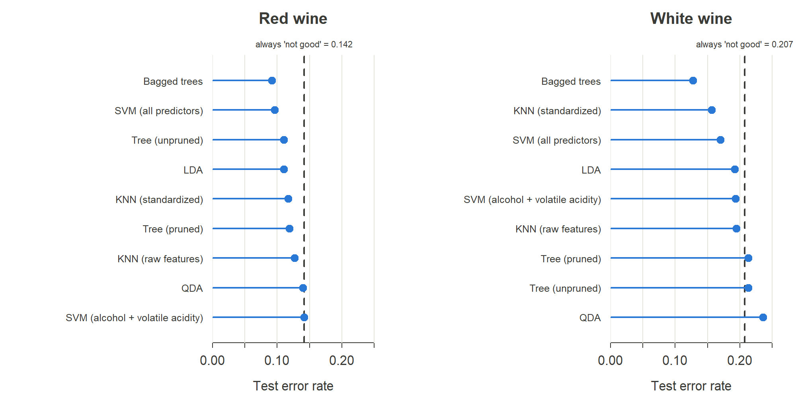
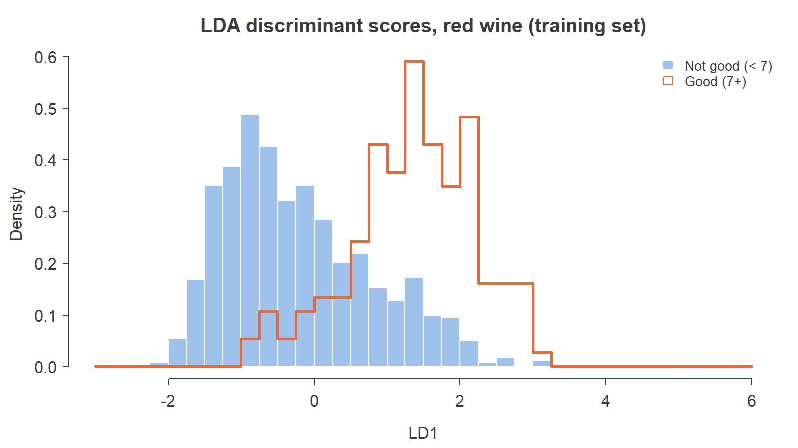
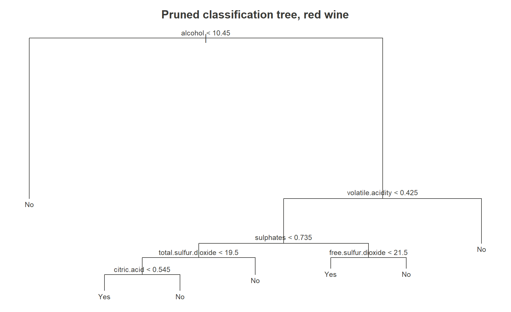
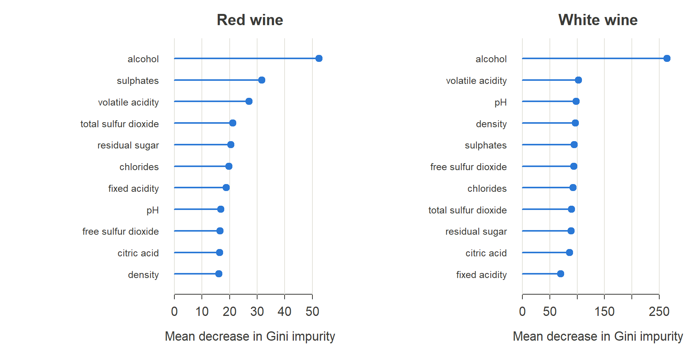
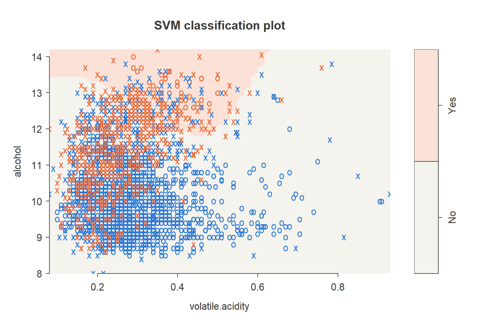

```{r setup}
m  <- read.csv("../results/metrics.csv")
p  <- read.csv("../results/parameters.csv")
cb <- read.csv("../results/class_balance.csv")

# Look up a metric for one wine and model, formatted for inline text
e <- function(wine, model, col = "error", digits = 3) {
  formatC(m[m$wine == wine & m$model == model, col], format = "f", digits = digits)
}
pct <- function(x) paste0(round(100 * x), "%")
par_val <- function(wine, name) p$value[p$wine == wine & p$parameter == name]
cbv <- function(wine, col) cb[cb$wine == wine, col]
base <- "Baseline (always 'not good')"
```

# Introduction

Portugal's Vinho Verde region certifies its wines with laboratory tests that
measure each batch's physicochemical properties, such as acidity, sugar, sulfur
dioxide and alcohol. Each wine is also scored for quality by a panel of expert
tasters. Cortez et al. (2009) collected these records and used regression models
to predict the tasters' 0–10 score. I asked a simpler question: **can the lab
measurements alone tell a good wine from an ordinary one?**

To answer it, I turned the score into a binary label. A wine is *good* if it
scored 7 or higher, and *not good* otherwise. I chose 7 as the cutoff because
very few wines score 8 or above, and a higher cutoff would leave too few good
wines to learn from. I then compared nine models on held-out data, covering
linear, nonparametric, tree-based and kernel methods.

# Data

The data contain `r format(cbv("red", "n"), big.mark = ",")` red and
`r format(cbv("white", "n"), big.mark = ",")` white wines. Each has 11
predictors: fixed acidity, volatile acidity, citric acid, residual sugar,
chlorides, free and total sulfur dioxide, density, pH, sulphates and alcohol. I
modeled red and white wines separately because their chemistry differs
systematically. I split each data set at random into a 70% training set and a
30% test set.

Two features of the data shape everything that follows:

- **The classes are imbalanced.** Only `r pct(cbv("red", "share_good"))` of red
  wines and `r pct(cbv("white", "share_good"))` of white wines are good. As a
  result, a "model" that labels every wine *not good* already has a test error
  of `r e("red", base)` on red and `r e("white", base)` on white. Any useful model
  has to beat this baseline, and it also has to identify the good wines. For that
  reason I report **sensitivity** (the share of good wines a model catches)
  alongside the error rate.
- **The classes overlap heavily.** Good and ordinary wines have similar
  chemistry, so no decision boundary separates them cleanly.

# Methods

I fit the models in three stages, and each stage built on what the previous one
revealed.

1. **K-nearest neighbors, LDA and QDA.** These three are standard starting points
   that span a range of flexibility. For KNN, I chose *k* by leave-one-out
   cross-validation on the training set. I ran KNN twice: once on the raw
   measurements and once on standardized ones.
2. **Classification trees.** I fit an unpruned tree, then a pruned tree whose size
   was chosen by 10-fold cross-validation, and finally a bagged ensemble of 500
   trees.
3. **Support vector machines** with a radial kernel. I fit one SVM on the two
   predictors the trees identified as most important, and another on all 11. In
   both cases I tuned the cost parameter by 10-fold cross-validation.

I scored every model on the test set, which none of the models saw during
fitting or tuning.

# Results

```{r results-table}
#| tbl-cap: "Test error rate and sensitivity (share of good wines correctly identified) for each model."
show <- c("KNN (raw features)", "KNN (standardized)", "LDA", "QDA",
          "Tree (unpruned)", "Tree (pruned)", "Bagged trees",
          "SVM (alcohol + volatile acidity)", "SVM (all predictors)")
row <- function(model) {
  r <- m[m$wine == "red" & m$model == model, ]
  w <- m[m$wine == "white" & m$model == model, ]
  data.frame(Model = model,
             `Red error` = sprintf("%.3f", r$error),
             `Red sens.` = pct(r$sensitivity),
             `White error` = sprintf("%.3f", w$error),
             `White sens.` = pct(w$sensitivity),
             check.names = FALSE)
}
tab <- do.call(rbind, lapply(c(base, show), row))
tab$Model[1] <- "Baseline: always \"not good\""
knitr::kable(tab, align = "lrrrr")
```

{width=100%}

## KNN, LDA and QDA

KNN's weakness in this problem turned out to be scale rather than
dimensionality. The sulfur dioxide measurements run into the hundreds, while
most other predictors are below 1. On raw features, the distances KNN relies on
are therefore driven almost entirely by sulfur dioxide. Standardizing the
predictors cut the white wine test error from `r e("white", "KNN (raw features)")`
to `r e("white", "KNN (standardized)")`, and the red error from
`r e("red", "KNN (raw features)")` to `r e("red", "KNN (standardized)")`.

LDA was the strongest of the three on red wine, with a test error of
`r e("red", "LDA")`. That figure looks good, but it hides a problem: the model
caught only `r pct(as.numeric(e("red", "LDA", "sensitivity")))` of the good
wines. Its low error comes mostly from correctly labeling the majority class.
QDA did worse than LDA on both wines, and on white wine it did worse than the
baseline. QDA estimates a separate covariance matrix for each class, which is 66
parameters per class here. With only `r cbv("red", "good_train")` good red wines
in the training set, those estimates are noisy. Several predictors are also
heavily skewed, which violates the normality assumption QDA depends on more
heavily than LDA does.

The LDA discriminant plots show the underlying difficulty. Good wines shift to
the right of ordinary ones, but the two distributions overlap substantially.

{width=80%}

## Classification trees

The trees showed that **alcohol** is by far the most informative predictor in
both wines. The first split in each tree is on alcohol content. In red wine, the
next most useful predictors are volatile acidity and sulphates. The unpruned red
tree had `r par_val("red", "unpruned tree leaves")` leaves, while the white tree
had only `r par_val("white", "unpruned tree leaves")`. Few of the possible splits
in white wine reduced deviance enough to pass the tree's default stopping rule,
which is another sign of how much the classes overlap.

Pruning chose `r par_val("red", "pruned tree leaves")` leaves for red wine and
`r par_val("white", "pruned tree leaves")` for white. It made the trees much
easier to read but did not improve accuracy: red test error rose slightly, from
`r e("red", "Tree (unpruned)")` to `r e("red", "Tree (pruned)")`, and white was
unchanged. Bagging was the clear improvement. It reduced test error to
`r e("red", "Bagged trees")` for red and `r e("white", "Bagged trees")` for
white, the best results in the study. Averaging over 500 bootstrapped trees
lowers the high variance that makes a single tree unstable.

{width=90%}

{width=100%}

## Support vector machines

Because the trees singled out alcohol and volatile acidity, I first fit an SVM
on just those two predictors. It failed. On red wine, cross-validation chose the
smallest cost in the grid, and the resulting model predicted *not good* for
every wine, so its error equals the baseline. On white wine it beat the baseline
only slightly and caught `r pct(as.numeric(e("white", "SVM (alcohol + volatile acidity)", "sensitivity")))`
of the good wines. The decision region plot shows why. In these two dimensions,
good and ordinary wines are interleaved. The white wine model needed
`r format(par_val("white", "SVM support vectors (2 predictors)"), big.mark = ",")`
support vectors out of `r format(cbv("white", "n_train"), big.mark = ",")`
training wines, which means a large share of the data sits on or inside the
margin.

{width=85%}

Using all 11 predictors helped considerably. Test error fell to
`r e("red", "SVM (all predictors)")` for red, nearly matching bagging, and to
`r e("white", "SVM (all predictors)")` for white. The two strongest predictors
carry much of the signal, but the other nine still add information.

# Discussion

Lab measurements can predict wine quality, but only partly, and the error rate
alone overstates how well. The bagged trees performed best on both wines. Their
error was about a third below the baseline on red and close to 40% below it on
white. Even so, they caught only about half of the good wines. For a winery
deciding which batches to promote, sensitivity matters as much as overall
accuracy, and the models are noticeably weaker on that measure.

White wine was harder to classify across almost every method. The size of the
data set is not the reason; more observations do not make a classifier less
accurate. Part of the gap is mechanical. Good wines make up
`r pct(cbv("white", "share_good"))` of white wines but only
`r pct(cbv("red", "share_good"))` of reds, so even the baseline error is higher
for white. The rest reflects greater overlap between the classes in white wine,
which shows in how few useful splits the white tree could find.

I also considered raising the cutoff to 8, but too few wines would qualify as
good, and the class imbalance would become much worse. Applying class weights or
choosing a different classification threshold would be a more direct way to
trade a little overall accuracy for higher sensitivity.

Cortez et al. treated quality as a numeric score and used regression, with
support vector regression giving their best results. Their approach keeps
information that a binary label discards. A wine scoring 6 and one scoring 3
are both *not good* to my classifiers, but they are very different wines.
Ordinal logistic regression would be a natural middle ground. It respects the
ordering of the scores, and it stays simple and interpretable, with one set of
coefficients and a series of cutpoints between adjacent quality levels.

Finally, the response variable itself limits how well any model can do. Each
wine's score is the median of at least three blind tastings, and tasters judge
aroma, appearance and taste. None of these are recorded directly in the lab
data. The two strongest predictors do have plausible sensory explanations.
Higher alcohol gives a wine more body and warmth. Volatile acidity, which is
mostly acetic acid, gives a vinegar-like off-note at high levels and is treated
as a fault. Still, much of what a taster responds to is not captured by these 11
measurements. A different panel could also score the same wine differently, so
some irreducible error is unavoidable.

## Limitations

- **Duplicate records.** About 15% of red wines and 19% of white wines have
  predictor values identical to another wine. Some duplicates fall in both the
  training and test sets, which flatters methods that can memorize individual
  points, such as KNN with *k* = 1 and bagged trees. Removing duplicates before
  splitting would give a more conservative estimate.
- **One train/test split.** All results come from a single random split. Repeated
  cross-validation would show how much the ranking of models depends on which
  wines happen to fall in the test set.

# Conclusion

I compared nine classification models for predicting whether a Vinho Verde
wine is rated good from its lab measurements. Bagged trees performed best, with
SVMs on all 11 predictors close behind for red wine. Alcohol content was by far
the most important predictor. However, because the classes are imbalanced and
overlap heavily, even the best models identify only about half of the good wines,
and several popular methods do no better than always guessing *not good*. The
most important lesson of the project is to compare every model against that
baseline, and to measure how well it finds the minority class, before trusting
its accuracy.

# References

Cortez, P., Cerdeira, A., Almeida, F., Matos, T., & Reis, J. (2009). Modeling
wine preferences by data mining from physicochemical properties. *Decision
Support Systems, 47*(4), 547–553. <https://doi.org/10.1016/j.dss.2009.05.016>

Cortez, P., Teixeira, J., Cerdeira, A., Almeida, F., Matos, T., & Reis, J.
(2009). Using data mining for wine quality assessment. In *Discovery Science*
(Lecture Notes in Computer Science, Vol. 5808, pp. 66–79). Springer.
<https://doi.org/10.1007/978-3-642-04747-3_8>

---

*Originally written as the final project for STAT 7510; revised in 2026. Code
and data: see the repository README.*
